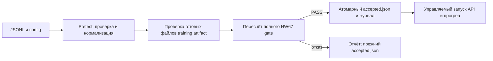

# ДЗ 8+9+10: выпуск, восстановление и сервис

## 1. Окружение

Apple M4 Pro, 48 GiB RAM, macOS 26.2, Python 3.12.14. Реальная модель работает
на MPS, bfloat16. Prefect 3.9.1, FastAPI 0.142.2, Uvicorn 0.54.0,
PyTorch 2.14.0, Transformers 5.17.0, PEFT 0.21.0, MLflow 2.22.2.
Полные сведения: [environment.json](../evidence/environment.json),
все транзитивные версии: [uv.lock](../uv.lock).

[defects.csv](../defects.csv) связывает семь независимых причин с исправлениями
и тестами. Восемь новых исходно совместимых тестов запущены на настоящем
прототипе из Downloads: **8 тестов, 21 содержательный отказ**, exit 1.
Причины отказов — неправильные статусы HTTP, кеш и журнал, а не ошибки импорта
или несуществующие команды: [красный лог](../evidence/integration-before.log).
Исправленный полный прогон: **31 тест, OK, exit 0**:
[зелёный лог](../evidence/check-all.log). Включены 13 неизменённых публичных
и 18 собственных проверок; три собственных теста обращаются к настоящему
локальному HTTP, четыре — к процессам выпуска, есть disk mock и проверка отката.
Дополнительные семь тестов пересчитывают реальный gate без загрузки весов.

Публичный `tests/test_release.py` совпадает с оригиналом побайтно, SHA256
`03632e58fa10f8742a205ae04ecba956f7a7cd0a0cfb90fc7fa9d32d6f2c1d7e`.
Тесты HW67 сохранены: [24 регрессии, OK](../evidence/hw67-regression.log).
Намеренный bypass валидатора только в памяти дочернего процесса даёт exit 1,
пять провалов проверки чужих binding:
[intentional-failure.log](../evidence/intentional-failure.log).
Исходники после этого не требуют восстановления, поскольку не менялись.

## 2. Переиспользование HW67 и настоящее решение

Повторного обучения и sweep нет. Получен существующий training run
`041aa4e127c04f228eb8dc15b6025ca0`, Registry `models:/my-qwen-adapter/1`.
Происхождение, метрики и training manifest:
[training-origin.json](../evidence/real/training-origin.json).
Прежний evaluation run HW67: `5a00cc4685224ad2869ce51161f3024e`.
В HW8910 полные 50 golden + 3 behavioral вопроса заново оценены одинаковым
`RealBackend`, который загружает API; новый MLflow evaluation run:
**`ac836d755ec349109010c6b3d629fadc`**.

| Модель | Accuracy | Format rate | Ошибки генерации | Behavioral |
|---|---:|---:|---:|---:|
| прежняя baseline Qwen3-1.7B | 40/50 = 0,80 | 50/50 = 1,00 | 0 | 2/3 |
| кандидат HW67, all-r8-high | 40/50 = 0,80 | 50/50 = 1,00 | 0 | 2/3 |

Неизменённый `quality_gate` HW67 вернул **отказ: «Не пройдены обязательные
behavioral-кейсы»**. Пороги не ослаблялись. Ни равная общая accuracy,
ни уменьшение val_loss не дают разрешения на выпуск.
Полные срезы, per-item и ответы:
[baseline-eval](../evidence/real/source/baseline-eval.json),
[candidate-eval](../evidence/real/source/candidate-eval.json),
[baseline outputs](../evidence/real/source/baseline-outputs.json),
[candidate outputs](../evidence/real/source/candidate-outputs.json).

Сохраняется предыдущая baseline, закреплённая в HW67 `evaluation/baseline.json`.
Она тоже не проходит новый полный behavioral gate. В принятом manifest это
явно обозначено `acceptance.kind=retained_baseline`; ей не создан фиктивный PASS.
Bootstrap восстанавливает существующую baseline из точной публичной revision,
не публикует кандидата и не меняет MLflow alias. Не объявляется наличие второй
реально допущенной версии: A→B→A отдельно доказывается на STUB.

## 3. Граф и кеш



Задачи передают небольшие словари: URI, model/run ID, хеши, путь к подготовленным
данным и отчёту. Веса и тензоры не являются результатами задач. Подготовка реально
разбирает JSONL, проверяет непустые input/text, нормализует и сохраняет результат.
Схема и отсутствие train/golden утечки дополнительно проверяются полным gate.

Ключ ядра — SHA256 канонического JSON `{data_sha256, config}`. Он независим
от пути и порядка ключей. В реальном config есть точная revision токенизатора,
хеш его файлов, chat template, max_length=2048 и SHA256 кода подготовки `lab.py`.
Prefect добавляет workspace namespace, чтобы не возвращать путь другого опыта.
JSONL и descriptor сохраняются на диск, `persist_result=True`; при чтении
повторно проверяется хеш payload. Остальные задачи имеют `NO_CACHE` и retries=0:
неполная схема, несовместимые веса и качество повтором не исправляются.

[Четыре настоящих Prefect runs](../evidence/prefect/summary.json):

| Опыт | Flow run ID | Exit | Подготовка | Публикации B |
|---|---|---:|---|---:|
| сбой после подготовки | `dc161420-720b-480f-8647-ae585b4fe9d2` | 1 | Completed | 0 |
| новый процесс | `61fdfa33-c107-4dd0-a541-a0adef31296f` | 0 | Cached | 1 |
| повтор выпуска | `4c5e6df0-a41a-440a-b5c6-d105b5c53327` | 0 | Cached | 1 |
| новые байты по тому же пути | `42ec688e-8238-45f9-b008-d09bdba9aac9` | 0 | Completed, PREPARED | 1 |

Команды, состояния задач, хеши и stdout — в `evidence/prefect/`.
[Дополнительные process-опыты](../evidence/process/evidence.json) проходят 25/25,
включая независимое изменение четырёх параметров. Идентичность результата
задаётся содержимым/настройками; каждая попытка имеет отдельный UUID и flow run ID.

## 4. Gate и публикация

Manifest закрепляет список относительных файлов → SHA256, aggregate model hash,
base revision, tokenizer/template, system instruction, do_sample=false, seed=42,
enable_thinking=false, max_new_tokens=32, dtype/device и SHA256 реализации генерации.
Те же файлы повторно хешируются перед публикацией и загрузкой. У адаптера закреплены
его веса, adapter_config и файлы точной базы. Runtime в eval совпадает с manifest
и фактически читается API; изменение генератора требует новой оценки.

[release-report.json](../evidence/real/release-report.json) создан кодом после
вызова настоящего gate, содержит ссылки и SHA256 полных отчётов/сырых ответов,
protocol/golden/runtime/model bindings и evaluation run ID. `gate_verify.py`
перепроверяет хеши, заново считает score и behavioral, проверяет trusted baseline
и вызывает прежний gate. Ручное `passed=true`, даже с обновлёнными внешними хешами,
отклоняется тестами. Синтетический PASS допускается только в явно помеченной
fixture-конфигурации стенда; это не свидетельство оценки настоящих весов.

`validate_release` дополнительно требует complete, настоящий bool True,
непустой eval ID, конечные численные accuracy/format_rate и точные bindings.
Запись — временный файл рядом с указателем → flush/fsync → os.replace.
Ошибка replace моделируется mock; прежние байты остаются и tmp удаляется.

Реальный отказ [flow log](../evidence/real-flow-rejection.log), exit 1:

```text
SHA256 accepted.json ДО    = 130633642a1599d5b69f56cca9d1c5432462973dca991ea96f9a003ae0d88c4b
SHA256 accepted.json ПОСЛЕ = 130633642a1599d5b69f56cca9d1c5432462973dca991ea96f9a003ae0d88c4b
```

Неполный/чужой отчёт, False, NaN, disk error также сохраняют указатель.
Каждая попытка записана отдельно в attempts; идентичность выпуска включает
канонические manifest и report, следовательно runtime и решение eval.
Durable intent перед заменой указателя позволяет после сбоя между указателем
и журналом добавить недостающее событие единожды; повтор затем ALREADY_PUBLISHED.
Журнал заменяется атомарно. Модель одного писателя; гарантий нескольких писателей
и отключения питания между всеми файловыми операциями не заявляется.

## 5. Быстрые проверки и события

| Изменение | Конкретные действия |
|---|---|
| код | `make check-light`; при изменении `real_backend.py` — `make real-evaluate` до нового выпуска; документация не требует обучения |
| данные | `make check`, `scripts/evidence.py` проверяет cache invalidation; новая golden-версия — полная оценка; изменение train требует обоснованного нового training run |
| адаптер | получить законченный run, проверить точную базу и файлы; `make real-evaluate`; `flow.py --manifest manifest-candidate.json --report release-report.json`; перезапуск только после PASS |

CI выполнен локально. Шаблон Actions приложен, фактический удалённый run и merge
protection не настроены. Быстрые проверки запускаются в `.venv-check` без torch
и весов, полный runtime установлен отдельно через extra `model`.

## 6. API, версия и ограничения запроса

FastAPI начинает принимать health до завершения фоновой загрузки. Ready и ранняя
генерация дали 503; после проверки файлов, загрузки и прогрева — 200.
[Полный реальный smoke](../evidence/real-smoke.json) записывает статусы,
request_id, фактически загруженный model ID, runtime hash, число токенов и время.

Реальный ответ: `{"answer":"B"}`, 6 новых токенов, generation ≈0,319 с,
total ≈0,325 с. В этом golden-вопросе ожидается A: smoke подтверждает реальную
загрузку и HTTP-контракт, а не исправность каждого ответа. Ошибка уже отражена
в знаменателе полной оценки. Runtime:
`f73e558a2384de53005f9d1e892cb8a1fc2046c159dab63433536f4b631eeadf`.

Пустой prompt, 0/100000/string лимит, отличный от оценённого лимит 16 и слишком
длинный токенизированный prompt дали 422, calls до/после одинаковы.
Максимум 8192 символа prompt, 2048 входных токенов вместе с system, HTTP body
64 KiB; реальный max_new_tokens ровно 32. Вычисление одно, очередь до 60 секунд.
Очередь ожидания не ограничена числом ожидающих клиентов; это ограничение стенда.

Manifest загружается однократно; ответ использует ID backend в памяти.
Тест `test_http_loaded_version_changes_only_after_restart_and_rolls_back`
проверяет STUB A → публикация B при прежней A в памяти → restart B → rollback
принятой A → restart A. Это отдельный инженерный опыт. Настоящая baseline
также успешно повторно загружена после перезапуска, с тем же runtime и ответом.

## 7. Замер после прогрева

Одинаковые первые восемь вопросов настоящего golden в обоих режимах,
max_new_tokens=32; фактически по 6 выходных токенов на запрос. Ошибки и таймауты
не удаляются; в этом прогоне их не было. [Все 16 строк](../evidence/benchmark/requests.jsonl),
[metadata](../evidence/benchmark/metadata.json), [CSV](../evidence/benchmark/summary.csv).

| Concurrency | N | Успех/ошибка | Пакет, с | Успешных req/s | Mean client, с | Max client, с | Mean generation, с | Mean queue*, с |
|---:|---:|---:|---:|---:|---:|---:|---:|---:|
| 1 | 8 | 8/0 | 1,957 | 4,088 | 0,244 | 0,263 | 0,241 | 0,001 |
| 2 | 8 | 8/0 | 2,780 | 2,878 | 0,658 | 0,788 | 0,346 | 0,308 |

*queue_seconds включает проверку токенизированного входа до получения semaphore,
а также само ожидание. Ошибочные задержки отдельно `null`, поскольку ошибок нет.

При двух клиентах backend продолжает вычислять последовательно; второй ждёт,
поэтому задержка выросла. На маленьком прогоне выросло и время самой генерации:
есть шум, конкуренция CPU-подготовки и GPU-синхронизация. Эти 8 запросов не доказывают
стабильный throughput/p95. Последовательный режим оказался быстрее именно здесь.

Prefill обрабатывает весь вход; decode последовательно генерирует токены.
KV-cache растёт с длиной контекста, числом слоёв, KV-heads, размером head и числом
одновременных последовательностей; здесь semaphore допускает одну генерацию.
Измерена полная задержка JSON-ответа. Streaming, TTFT, ITL, устойчивый p95,
максимальная насыщенная нагрузка и сравнение SGLang/vLLM не измерялись.

## 8. Сдача и воспроизведение

[README](../README.md) содержит команды от лёгких тестов до модели, полного gate,
и нагрузки. Реальный eval лог: [real-evaluation.log](../evidence/real-evaluation.log).
Первый медленный CPU-опыт был остановлен после обнаружения доступного MPS;
его неполный журнал сохранён отдельно и не выдаётся за законченный eval.

Веса, окружения, кеши, Docker-volumes и секреты не включены в Git/архив сдачи.
Публичную baseline преподаватель может скачать по точной revision через
`scripts/restore_baseline.py`; проверка восстановления по сохранённым хешам
выполнена в отдельном workspace. Локальный адаптер доступен через MLflow HW67;
все его измеренные ответы и полные отчёты приложены независимо от доступа к весам.
